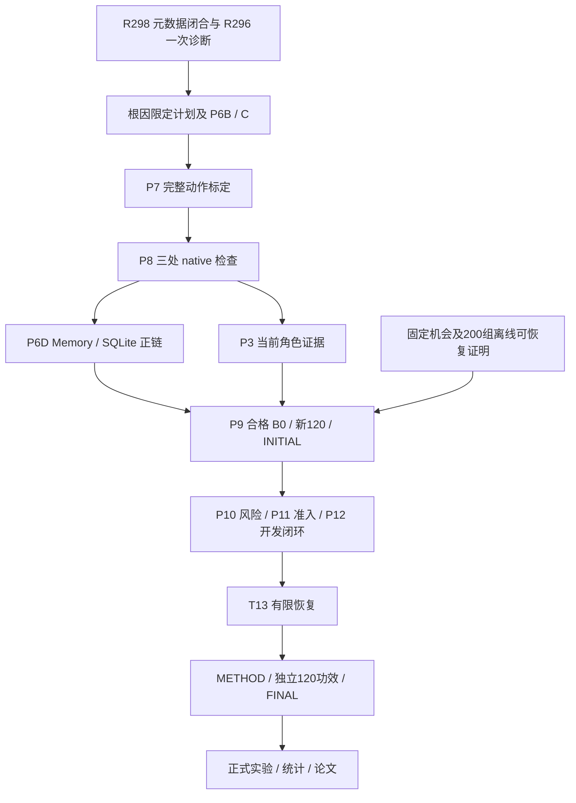

# 开题后续开发计划 Implementation Plan

> **For agentic workers:** REQUIRED SUB-SKILL: Use superpowers:subagent-driven-development or superpowers:executing-plans to implement this plan task-by-task. Steps use checkbox (`- [ ]`) syntax for tracking. 委派、执行身份和运行额度仍须遵守 AGENTS.md 及对应轮次计划。

**Goal:** 先获得可独立核验的基础抓放闭环和合格基线，再验证一致性检查、事件驱动协同决策、有限恢复三项研究内容，按开题安排完成实验和论文。

**Architecture:** 沿用 Qwen3.8-Max 云端规划、边缘规则与成本策略、端侧 OpenCV/RGB-D/既定控制器。使用现有七关节 Franka-like 物理仿真、可见姿态标记和顶视相机。边缘模型选型后置；真实硬件另行验证。

**Tech Stack:** Python、OpenCV、MuJoCo、现有 Memory/SQLite 仓储与异步执行器、现有云模型接口。

**Spec:** [当前研究设计](../specs/2026-10-04-cloud-edge-device-research-design.md)、[既有 P1–P12 执行计划](2026-10-07-t12-sol-execution.md)、[修订开题 PPT](../../../output/doc/20261021-proposal-revision/开题报告_修改版.pptx)、[修订开题报告](<../../../output/doc/20261021-proposal-revision/开题报告-2501220176 宁业栋_修改版.doc>)。

**基准：** 2026-10-22；分支 `research/20261004-continuation`；输入提交 `220d50267d1a850361f9a357f9dc45ebb2b05de7`。这是新的规划快照，产品仍为**未验收版本**。本轮只交付计划和文档核对，不启动诊断、测试、模型请求或物理运行。

## Global Constraints

- 每轮新问题先由实际 `gpt-6-astra` 制定限定计划，实施前核对输入、角色和额度。本总计划不释放 R298/R296 门禁，不新增运行次数。
- 软件验证、真实采集、真实模型调用、物理结果、正式研究验收分别记录。历史失败和冻结字节保留；新结果不能补写成历史原件。
- 在线决策只用可观测证据；独立物理真值只供离线评价。UNKNOWN 保持 UNKNOWN，不能通过扩大 TTL、伪造有限误差界或取消安全检查获得通过。
- 每个 provider 在途请求上限 1，最新待发观测有界合并；云模型不进入实时伺服环。取消、硬停止、原始截止时刻和剩余预算持续有效。
- 标定、策略选择、基础先导、功效先导和正式测试按来源组隔离；所有派生帧跟随原组。已分配失败、超时、停止、BLOCKED 保留在统计分母。
- 请求、计费用量、账单费用、通信字节、本地资源分别统计；未知费用为 `null`。仿真结论限定在实际运行条件，不能推算特定板卡能耗或实机性能。
- 每项交付保存命令、退出码、原始证据、SHA256、适用范围与未通过项；按明确路径提交并推送研发分支，核对本地、上游、远端 SHA。

## Review Focus

1. RPC 迟答与观测器丢记录：任务 1 区分诊断完整、产品根因、行为验收，任何一项未知均不晋升。
2. 旧观测、租约失效、取消及版本冲突：任务 2/5 覆盖决策后、提交前、实际启动前的变化，保持截止时刻和拒绝路径。
3. 标定来源不独立、缺完整动作范围、部分可见误判成功：任务 3 要求独立来源和保守误差界，正常动作与拒绝反例同时存在。
4. 基线不合格或测试数据参与调参：任务 4/7 保持全候选、独立数据池和冻结顺序，不从低质量基线推导节省结论。
5. 消融名称不同、重复执行已完成动作、成本漏记：任务 5/6/7 明确方法开关、效果依赖和全请求账本；论文中区分机制收益与部署边界。

## 1. 当前起点与优先级

| 范围 | 已有事实 | 仍须完成 |
|---|---|---|
| 开题材料 | 12 页 PPT、14 页 Word 已按现状修订；研究方向为工程管理，进度至 2027 年 5 月 | 将三项研究内容落实为可运行方法和独立实验 |
| 基础与云通道 | 存在历史技能、离线教师及真实云请求成功证据 | 历史教师成功不能替代当前在线闭环；旧基础先导仅 5/120 成功、静态 4/40 |
| 运行基础 | P6 内部 T1 软件范围获 ROOT 受限接受；R289 Memory/SQLite wait 两项有受限行为证据 | P6B 内部 T2/T3、P6C、P6D 未整体完成 |
| 最近行为 R289 | 双重失效场景 child exit 1，wrapper exit 0；在 `commit-seam-0` 准备阶段 `reserve_plan` 失败，尚未进入目标提交失效注入 | RPC 等待超时与 broker 迟答的根因未知；7 条被动事件、10 条丢弃，现有诊断不完整 |
| 最近准备 R299 | 63 项检查通过，仅放行 R298 源码准备；R298 完成器文件已准备、尚未执行 | R298 元数据执行和 R296 一次诊断均未释放；R296 额度仍为 used 0 / remaining 1 |
| 当前配置 | `ced_roles.yaml` 中 `dispatch: false`、`local_recover_enabled: false`、`status: NOT_ACCEPTED`；selection/foundation 的关键证据绑定仍为 null | native 动作资格、INITIAL、在线协同、恢复、METHOD/FINAL 及正式实验 |

这里的 **P6 内部 T1/T2/T3** 与总路线图历史 T1/T2/T3 不同；不得混用完成状态。阶段总结只记录到 R289，最新准备状态需同时查 R298/R299。

**优先顺序：运行链路 → 标定与基础抓放 → 合格 B0/INITIAL → 协同决策 → 恢复 → 正式实验。** 第一项产品里程碑是可核验的正常动作正链；首批标定动作只证明该来源范围，完整在线任务仍需后续独立场景验证。

### 关键依赖

P6 完整顺序保持 **A → B → C → P7/P8 → D**，不要求 P7 等待 D。P7 CPU 准备及固定机会协议整理可在不触碰共享源码、教师保护范围和运行资源的条件下提前进行。P9 离线可恢复证明不依赖 T13 在线恢复；T12 开发准入不等待 METHOD/FINAL。

## 2. 近期工作包

以下是未来执行清单；本次不勾选产品任务。已有精确接口、测试节点与命令从对应计划复用，实施时逐项核对适用性；未确认的修复方案交由当轮 Astra 定义，不预先指定产品改法。

### Task 1：完成当前诊断接续

**输入/文件：** `astra-rounds/round298-p6-t2-plugin-finalization-eof-byte-generation-20261017/implementation/complete-source-evidence.py`；R296 的 `implementation/run-evidence.py` 与 `r296_session_evidence.py`；R299 `step-report.json`。本节 `astra-rounds/` 均指 `artifacts/research/process/20261004-ced-development/astra-rounds/`。

**接口：** R298 元数据证明 → ROOT 对 R296 source/native/argv/27 源及 211 保护项的检查 → 同一个 `R296.dual_rpc_timeout_evidence` 额度。

- [ ] 核对当前输入、R298 预期输出是否仍缺失、原失败是否保留，以及旧作者席位是否仍可用。席位不可用时先取得实际 Astra 的角色接续决定，不冒用旧身份。
- [ ] 复核已准备的 R298 完成器全文、精确命令和单次元数据执行条件，再按原计划完成该证明；保留原 R297 expected-match=false 事实。
- [ ] 所有 R296 前置通过后，按原冻结命令登记并执行唯一诊断：节点 `tests/test_operational_runtime_closure.py::test_dual_database_order_and_partial_commit`，child 600 秒、outer 900 秒、重试 0；不得直接裸跑 pytest 或重跑两个已接受 wait。
- [ ] 独立读取进程/JUnit/资源/数据库/被动记录，区分产品执行、观测器开销和调度假设。无证据不选根因；诊断是否 PASS 不改变其诊断属性。
- [ ] 保存一次步骤报告和原始证据；有新根因或计划外失败时进入下一轮 Astra，再决定最小修复和行为验证。

**出口：** 一份可判断完整性的真实诊断包及根因结论/明确未知项。R289 原三槽仍已耗尽；35 个原数据库及 90 个 sidecar 的证据缺口仍保留。此工作包不验收 T2/T12。

### Task 2：闭合 P6B/C 的事务与执行边界

**文件：** `src/cloud_edge_robot_arm/simulation_runtime/operational_lease.py`、`worker_runtime.py`、`repositories/event_autonomy/{memory,sqlite,visual_owner,visual_verification}.py`、`vision/execution.py`；`tests/test_operational_runtime_closure.py`、`test_operational_time_v1.py`。精确允许修改子集由任务 1 之后的 Astra 计划限定。

- [ ] 按诊断证据处理 P6 内部 T2；只在后续适用计划分配的次数内重新验证目标提交失效与剩余场景。
- [ ] 对照 R158/R196 及后续适用记录，完成内部 T3 和 P6B 余项；独立审查使用明确剩余额度，不复用已耗额度。
- [ ] 完成 P6C 的 handler、动作队列、夹爪/控制器写入及每个 physics 循环边界；记录 D/S 时间、当前 owner、租约及原预算。
- [ ] 验证取消/租约失效后无迟到提交、ACK 不等于启动、重启不刷新原截止时刻，以及合法来源能够进入后续采集正链。

**出口：** B/C 各自范围的行为证据和独立决定。未测 suspend/跨 boot 等能力按真实支持范围列明；现有 UTC 附加 veto 的保留范围明确记载。共享仓储、worker 和 execution 由单一集成人串行修改。

### Task 3：建立动作标定、在线证据与最小正常正链

**文件：** `vision/{native_calibration,native_references,action_evidence,execution}.py`、`research/native_geometry_calibration.py`、`edge/evidence/conditions.py`、`edge/safety/shield.py`；验证入口沿既有 P7/P8，相关用例位于 `tests/test_native_calibration_source.py`、`test_native_references.py`、`test_native_action_submit.py`。

- [ ] 先做一个来源独立、覆盖完整动作时域的实际标定组，并由独立 reader 重算；单组不合格时停止批量采集。
- [ ] 单组成立后按冻结分组扩展到至少九个独立 component 组；缺未来动作范围、接触支持或保守误差界时保持 UNKNOWN。
- [ ] 将同一有效来源接入动作前安全、技能提交前、动作后效果三处检查；覆盖目标缺失、身份歧义、无效深度、部分可见及旧帧反例。
- [ ] 在启动时完整认证来源，再采新帧；测量提交热路径耗时和剩余 TTL，避免每次重新解码所有标定 raw。超时按原规则拒绝。
- [ ] 完成 P6D 的 Memory/SQLite 完整 native 正链；用独立新开发 assignment 保存观测→资格→提交→启动→效果的实际记录。

**出口：** P7/P8/P6D 限定验收、来源与误差报告、首个可核验动作正链。目标定位按独立几何真值计算误差，报告覆盖；完整任务成功须同时满足在线效果与独立物理判定。抬升≥50mm 且保持≥0.5秒；释放后目标区稳定≥1秒。单例成功不等于≥90%静态成功率。

### Task 4：取得合格基线与 INITIAL

**文件：** `configs/research/{ced_roles,ced_selection,ced_foundation}.yaml`；`research/{protocol_generation,protocol_evidence,freeze_evidence}.py`；`scripts/{run_rgbd_pilot,prepare_rgbd_protocol_evidence,freeze_rgbd_protocol}.py`。接口复用 `verify_role_probe_evidence`、`audit_ced_pilot_stage`、`initial_spec_from_evidence`。

- [ ] P8 受影响源码稳定后绑定当前云角色、配置和成本记录；若缺现行 role-probe 合同证据，按现配置完成 cold+3 warm 的最小增量，不重做历史 35 次连通性实验。
- [ ] 完成固定机会与 200 组离线可恢复性证明，含实际故障注入、教师恢复和独立结果；RW2/RW3 的教师墙钟守卫按既有计划完成。普通成功轨迹不充当故障证明。
- [ ] 在 120 个互斥 selection 组上配对筛选 0.5/1/2/5 秒周期，共 480 个分配 episode；记录所有候选和失败。
- [ ] 候选须静态成功率≥90%、整体≥80%、安全违规率≤1%；合格者中先选请求最少，再以时延破同分。无合格者保持 `NO_FEASIBLE_BASELINE`，预算不足保持 `INCOMPLETE`。
- [ ] 胜出后在另 120 个未用组做基础先导，填入真实 pools/role/protocol/selection 证据绑定；刷新成功路径时间、费用和存储预算，再冻结 INITIAL。此时不选正式 N。

**出口：** 合格 B0、完整新 120、INITIAL 和资源估计。旧 5/120 结果作为负结果保留，不能并入新验收。

### Task 5：完成一致性检查与事件驱动决策

**文件：** `vision/risk/{features,calibration,fit,models}.py`、`research/{risk_sources,risk_supervision,risk_replay}.py`、`auto_mode/{joint_policy,runtime_composition}.py`、`edge/recovery/verification_router.py`；配置 `configs/research/risk.yaml`。复用既有 P10/P11/P12 接口及测试设计，不另造动作执行器。

- [ ] 用独立 calibration/selection 来源校准风险和阈值，证据不足时限制可用能力；规则分数不标为模型概率。
- [ ] 对 task/episode、目标身份、observation、计划/模式/命令版本、候选集合、有效期执行返回时与提交前复核。
- [ ] 先依据能力/证据/预算生成有限合法候选，再比较风险、预计耗时与实测成本。保持 STOP，未验收 LOCAL_RECOVER 继续不可选。
- [ ] 在 INITIAL、风险、选择结果及 native 来源满足时开启限定开发准入；不能通过直接删除固定 STOP 或伪造 admission flag 开放执行。
- [ ] 按原 P12 冻结 8 个新场景×B0/B1/B2/T12a 共 32 个 episode：2 正常，以及缺目标、无效深度、取消、硬停、过期、迟到返回各 1。两个正常场景的四方法均须有完整正链；所有反例检查实际动作及拒绝依据。

**出口：** T12a 限定开发验收与全决策时间线。真实请求/字节/本地代价可重算；全 STOP、只跑负例或模型返回正确均不构成闭环完成。实际费用和成功率收益留正式实验判定。

### Task 6：完成基于效果依赖的有限恢复

**文件：** `cloud/replanning/{visual_dependencies,visual_repair}.py`、`edge/recovery/lifecycle.py`，沿用 ReplanApplyService 和现有仓储 CAS。

**接口：** `find_repair_window` 产生受影响窗口；`build_visual_repair(..., full_remaining=False)` 生成局部候选；B4 用同一输入和安全条件比较完整剩余计划修复。

- [ ] 用当前观测复核已完成效果，按依赖关系定位受影响的未完成后缀，保存保留步骤和替换步骤的原因。
- [ ] 验证 DETECTED→AUTHORIZED→EXECUTED→VERIFIED_RESOLVED；授权、ACK、动作返回均不单独代表恢复成功。
- [ ] 覆盖重复故障、恢复后验证失败、预算耗尽和重启：已完成的不可重复动作重提交为 0；原次数、远程调用预算和 60 秒恢复墙钟上限不刷新。
- [ ] 在独立开发故障组比较局部恢复与 B4，完成能力验收后再开放相应候选。

**出口：** T13 有限在线恢复证据和完整方法候选。P9 的 200 组离线资格证明、T13 开发验证、正式 G4 的 200 组恢复评价分别记录、隔离来源。

## 3. 方法冻结、正式实验与论文

### Task 7：对齐消融口径，完成 METHOD 与 FINAL

当前开题第 120 段写“一致性检查、协同决策、恢复”三模块消融；旧研究设计写“去不确定性、去时效性、去局部修复”。二者粒度不同，需要显式映射。

- [ ] INITIAL 前登记方法对照表和统计比较规则：B0=周期监督、B1=固定阈值、B2=现有规则 AUTO；纯本地方法用于能力边界，不能自动等同 B2 或取代合格 B0。
- [ ] 为开题三模块各定义方法 ID、精确开关、保留的基础安全与输入输出。旧细粒度消融能严格对应才复用；其余单列预算。B3/G3、B4/G4 保留既有用途，B5 属可选训练采样研究。
- [ ] METHOD 前冻结方法实现、provider、端侧算法、全部阈值/预算与对应 hash。消融仍保留基础身份/版本/安全边界，不以删除安全层比较收益。
- [ ] 用另 120 个互斥配对开发组仅估功效；按 α=0.05、power=0.8 及既定校正规则，从每方法 N∈{600,1200,1800,2400} 选择样本量。此批不再调参。
- [ ] 锁定样本、资源预算和完整来源后发布 FINAL；N>2400、预算不足或证据不够时如实标记，不追加至显著。

### Task 8：正式采集与统计

- [ ] 按 FINAL 在三任务层×四网络档位等预登记条件运行配对主比较和消融，同场景、物理 seed、网络日程、控制器、安全层和预算。
- [ ] 主比较、固定机会 G3、200 组正式 G4 及可选架构/训练扩展分表；保留所有分配与失败。正式数据不参与参数选择。
- [ ] 输出场景聚类/条件分层配对 bootstrap≥10000 次及 95% 区间、预定 Holm 校正、零事件单侧精确或 Wilson 界。基线值为 0 的相对变化记 N/A。
- [ ] 逐项判断下表，不用某一项通过抵消另一项失败；同时报告负结果、覆盖、UNKNOWN、误完成、无响应和适用边界。

| 研究指标 | 验收口径 |
|---|---|
| 感知与基础能力 G1 | 正确识别且有效深度目标定位 P90≤10mm，另报覆盖；独立静态抓放成功≥90% |
| 云介入 G2 | 对合格 B0 远程模型请求均值减少≥30%；成功率差单侧95%下界>−3个百分点；安全违规率差单侧95%上界≤+1个百分点 |
| 工程成本 G2a | 应用字节减少≥25%、含失败惩罚的任务耗时 P95 减少≥15%，分别判断；费用按可获得账单另报 |
| 一致性门控 G3 | 相对 B3 误放行减少≥50%且绝对≤2%；有效安全机会误拒≤5%；UNKNOWN 单列 |
| 恢复 G4 | 200 组正式故障恢复成功≥80%；含失败惩罚的恢复耗时中位数减少≥30%；已完成不可重复动作重提交0 |

相对改善点估计达到门槛与区间排除 0 分开记录。任务失败惩罚 `Tcap = clip(ceil(P99_B0成功耗时×2/10)×10,120,600)` 秒；恢复失败惩罚 `Rcap=60` 秒。

### Task 9：论文与复现交付

- [ ] 按“系统与接口—一致性—协同决策—有限恢复—实验与工程成本”组织论文，逐个结论链接原始证据、样本和区间。
- [ ] 整理源码/配置/协议/运行清单/失败记录和独立读出，注明数据获取方式、设备、软件版本与硬件未验证范围。
- [ ] 为必要补充验证新建冻结记录，不覆盖正式原数据；导师修改、送审与答辩按学院实际日期安排。

## 4. 月度安排与最近两周

以下为开题目标排期，按进入条件推进；不是已获批的计算时长或完成承诺。

| 时间 | 主任务 | 阶段出口与顺延条件 |
|---|---|---|
| 2026-10-22～10 月底 | 任务 1 接续、任务 2 计划与输入复核；同步整理指标/消融映射 | 当前诊断证据闭合并明确下一限定修复；诊断不完整则保留未知与新计划 |
| 2026-11 | 任务 2～4：运行基础、动作标定/闭环、四周期筛选、新120 | 合格 B0 + INITIAL；无合格基线或来源缺失则继续基础补强 |
| 2026-12 | 任务 5：独立风险、版本一致性、事件决策、32 个开发 episode | T12a 正常正链和拒绝反例完整；不以全 STOP 验收 |
| 2027-01 | 任务 6～7：效果依赖恢复、消融/方法冻结、独立120功效 | T13 + METHOD + FINAL；资源或门槛不足则顺延正式实验 |
| 2027-02 | 任务 8：正式配对对照、消融及 G3/G4 | 冻结方法、完整分母、可重算实验数据 |
| 2027-03 | 统计、成本/可靠性分析、论文初稿 | 逐项结论、区间、负结果与适用边界 |
| 2027-04 | 必要补充验证、论文修订定稿、送审及答辩材料 | 可核验交付包，注明 raw/数据库可获取性与限制 |
| 2027-05 | 按学院安排答辩和提交 | 以学院实际通知为准 |

**最近两周的检查点：** 第一周优先完成任务 1；第二周根据实际根因推进任务 2，准备任务 3 的单组采集与独立读出。只有 B/C 已满足前置才执行首组实际采集；两周结束时交付真实通过项、剩余阻塞与调整后的排期。不得预先承诺两周内完成全部 P6 或 INITIAL。

## 5. 资源与交付管理

- **小规模先行：** 一组完整标定原件合格后扩组；正式批量在 FINAL 后启动。CPU 文档/协议准备可独立进行，GPU 渲染与本地模型按实测串行排程。
- **运行前预算：** 根据新的完整成功/失败路径，填写每组墙钟、云请求/用量、原始证据字节、初始化和清理开销；计算 `Σ(阶段分配组数×该阶段方法数×实测单位开销)+单列固定/重跑预留`。同一方法可复用必须在冻结表明确，不能靠事后去重减分母。
- **已知规模：** B0 selection 480 episode、基础先导120组、T12开发32 episode、独立功效120组×冻结方法、正式 N×冻结方法数，另列离线200故障资格、正式200故障×比较方法、固定机会及标定。不能把 N 当总运行次数，也不能仅以 7N 估计全部研究成本。
- **费用前置：** 当前配置的 profile/证据绑定仍为 null；实际运行前核实现有服务 profile、角色 probe、余额/预算上限和磁盘空间。凭据只从现有安全入口读取，报告不写秘密；费用未知保持未知。
- **每周检查点：** 更新一次新阶段记录，列“输入版本、已完成范围、未通过项、运行额度、资源消耗、下一依赖”；同一根因合并一个修复轮次，避免反复宽测。新根因再交 Astra。
- **交付边界：** 每个验收包显式路径提交。完整批量 raw、运行数据库、权重/SDK 与凭据沿既定边界管理；远端清单不是完整复现包。当前两个历史嵌套工作区的脏状态保留，不在本轮提交。

## 6. 本轮计划的证据与交接

本轮 [Astra 计划](../../../artifacts/research/process/20261004-ced-development/astra-rounds/post-opening-development-plan-20261022/plan.md)、[结构化计划](../../../artifacts/research/process/20261004-ced-development/astra-rounds/post-opening-development-plan-20261022/plan.json)、[输入 SHA256 清单](../../../artifacts/research/process/20261004-ced-development/astra-rounds/post-opening-development-plan-20261022/source-index.json) 与本文件共同使用。近期开工从任务 1 的适用性复核开始，后续任务按前置逐项释放。

ROOT 自审范围为：开题时间/指标对齐、最新证据层级、文件与来源可定位、依赖无循环、原额度和失败保留、数据池隔离、消融映射与费用口径。文档核对结果与本轮阶段总结在同目录新记录中保存；历史 `phase-summary.md`、`active-t12-state.json` 及开题原件不改写。
