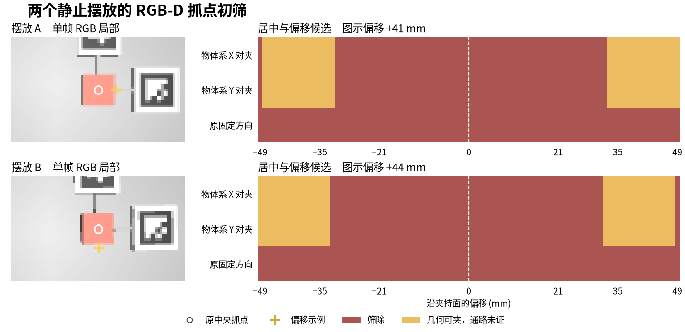

# G1 通用视觉抓点验证

两个预登记的新开发摆放都通过原顶视相机取得了有效方块定位。每个摆放检查 303 个抓点和方向组合，均有 72 个通过名义夹面、支架几何及静力平衡检查，但没有一个能在原固定腕姿、当前深度观测和运动边界下证明全程可以通过。两槽的第一段高位路径也均为未知。实际派发 **0/2**，完整抓放 **0 次**，本轮没有可计算的独立抓放成功率。[登记](prospective-registration.public.json) · [逐槽读回](development-dispatch.public.json)

| 新摆放 | 方块顶心两种估计的差 | 检出标记 | 筛除 | 通路未证 | 获准执行 |
| --- | ---: | --- | ---: | ---: | ---: |
| cvdev01（A） | 1.74 mm | ID7、ID8 | 231 | 72 | 0 |
| cvdev02（B） | 3.87 mm | ID7、ID8 | 231 | 72 | 0 |

颜色轮廓结合深度和同帧标记分别估计顶心。A 沿物体 Y 方向对夹、切向偏移 +41 mm，B 沿物体 X 方向对夹、切向偏移 +44 mm，按修正后的直接路径模型，在高位之后的扫掠中相对已登记实体的名义净距下界分别为 5.91 和 5.90 mm。两处的深度有效区域均给出了部分自由空间。混合深度像素仍覆盖夹爪所需的部分空间，且未取得适用于全程的跟踪及停车距离上界。原固定腕方向和最近方块面对齐尚差 0.127°、2.228°。闭爪时能否被动找正需要独立实测。[直接路径与力学复核](../round-g1-cv-sweep-route-binding-20261125/step-report.md)

图中白圈是原中央抓点，黄色加号是上文的两个偏移示例。右图绘制每方向 −49 至 +49 mm 的整数格。另两个投影边界点参与逐槽计数。红色包括已有几何冲突或不满足夹面条件，黄色代表名义几何可行、通行空间尚未证实。两张图均采于运动前。

## 历史碰撞和遮挡

12 张历史帧共 3,636 个候选，2,600 个被筛除，1,036 个通路未证。两条实际发生过禁碰的中心轨迹都被提前筛除。对 115 mm 装配，真实第 1221 步最先碰到 ID8 载板的是右指，提前筛选指出的限制构件不同。对 130 mm 装配，第 1228 步首先与 ID7 横梁接触的左指和提前判断吻合。两组接触前一步与接触步的净距分别为 +0.056 → −0.488 mm、+0.368 → −0.311 mm。两个独立进程冷读所得归档一致，另重读了候选封存之后才使用的 18 张晚期深度帧。[接触与晚期帧校核](postseal-contact.public.json)

在独立 MuJoCo 资格场景中，短时遮住两块标记触发原生失标。沿同一租约持位 16 个受监护物理步后，用原相机只采一张新图，即恢复 ID7 和 ID8。定位、IK 和执行前安全检查通过。修订版按全部候选重算时，正常帧从采图到拒绝为 **4.088 秒**，重观的新帧为 **4.137 秒**，均超出 100 毫秒反馈窗，且各有 72 个通路未证、0 个可执行。重观后派发与完成均为零。计时来自本次共享开发机。[原生恢复读回](recovery-report.md) · [修订版实时读回](recovery-readback-v2.public.json)

另一独立资格夹具以明确标注的接口正控检查原中心和 +7 mm 偏移，两者均以当帧目标通过原生拥有者签发、三项执行前检查和 SafetyShield。单次采图、轻量视觉处理及只读 IK 耗时分别为 35.45 和 36.10 毫秒，未包含 303 个候选的扫掠。此处无技能派发，五类负控和原始时刻回放另行留存。[资格入口与独立读回](../round-g1-cv-qualification-entry-20261125/step-report.md)

## 原始失败与交付边界

首次静态复位被检查脚本误拒，原因为质量的浮点表示相差 1.39 × 10⁻¹⁷ kg。恢复项目原有的逐字段比较精度后，同两槽完成新采集。三个静态诊断复位合计输出两组完整图像与关节测量，运动命令和物理积分步均为零。初版路径把偏移拆成先到中央再横移，且固定腕四元数存在末位舍入差异，修正后按签发目标直接扫掠。还用解析受力对照修正了静力求解未能给出见证的情况，原始结果单独保留。[静态复位](../round-g1-cv-static-mass-verification-20261125/step-report.md) · [首版审查](sweep-review.public.json)

软件验证中，冻结原生夹具的导入一度污染合并测试的父进程。隔离两个已封测试节点后，两种收集顺序都得到相同的 245 项，完整合并运行全部通过。另有 112 项原生时钟、回放、截止及准入回归通过。归档资格脚本仍有行长、导入与循环内闭包等 Ruff 告警。其回调按各自帧、租约、签发记录逐项重连，两代已有的 14 个组件样本均归回原偏移；执行中的反馈样本为零。[合并回归](../round-g1-cv-verification-import-20261125/step-report.md) · [资格样本关联](../round-g1-cv-qualification-entry-20261125/qualification.public.json)

8 个原正式名额和 919 个冻结文件已逐项核对，合计 487,931,885 字节。原单标与低位双标的正式结果仍各为 0/4，本轮正式新增 0。公开交付含候选表、代码和读回摘要，完整传感数据与运行数据库依项目约定保存在本地。[冻结原件复核](formal-preservation.public.json) · [验证记录](verification.public.json)
