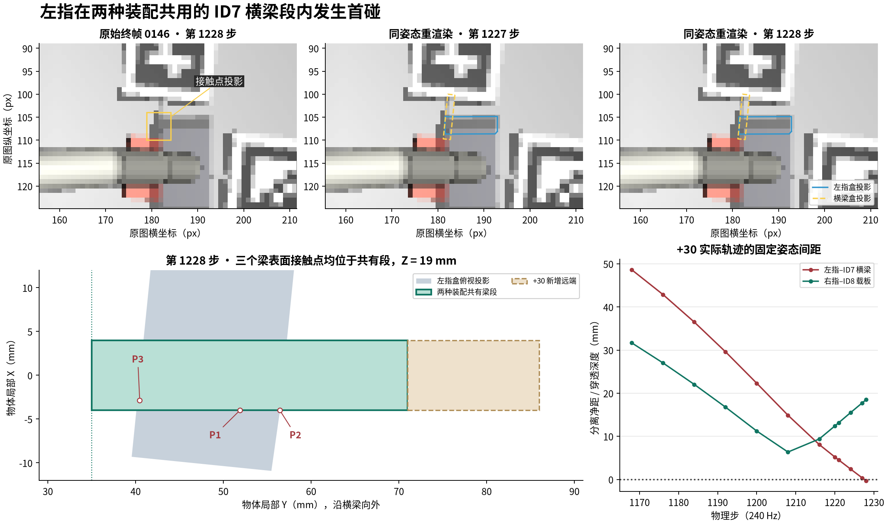

# 左指在何处碰到 ID7 横梁

130 mm 偏距装配（+30）的 d02 开发运行在第 1228 步接近方块时触发硬停。原记录给出三对左指与 ID7 横梁接触，同一步右指与 ID8 载板还有 18.501 mm 净距。用保存的关节、指位及物体姿态重新计算，左指在第 1227 步距梁 0.368481 mm，下一步穿入梁顶 0.311083 mm。把 115 mm 偏距装配（+15）放在同一姿态上，得到相同的左指接触。下文中正值表示两表面最近距离，负值表示沿分离轴计算的穿入量。[实际停机记录](original-run.public.json) · [逐轴与双表面点](local-contact-geometry.public.json.gz)

## 三个接触点均落在两根梁的共同段

两套登记模型的梁在方块坐标中有相同截面，X 从 −4 到 4 mm，Z 从 17 到 19 mm。梁根都在 Y = 35 mm，+15 装配的梁端在 71 mm，+30 装配在 86 mm。第 1228 步重建的三个接触点在两套模型中相同。左指指向横梁的共同世界法向为 (−0.000340, −0.000278, −1.000000)，对应横梁局部 −Z。表中 X、Y、Z 是沿该法向截取的**梁表面点**，面标记分别使用各自盒的坐标系。[模型、世界坐标和双表面点](local-contact-geometry.public.json.gz)

| 点 | 梁表面 X, Y, Z（mm） | 指局部相交面 | 梁局部相交面 | 求解器原始距离（mm） | 沿法向的有符号表面间距（mm） |
| --- | --- | --- | --- | ---: | ---: |
| P1 | −4.000, 51.889, 19.000 | +X、−Z | −X、+Z | −0.134141 | −0.268282 |
| P2 | −4.000, 56.435, 19.000 | +X、+Y | −X、+Z | −0.104278 | −0.208557 |
| P3 | −2.844, 40.470, 19.000 | +X、−Y、−Z | +Z | −0.155542 | −0.311083 |

这三个点附近存在正体积的交叠。一颗半径 0.1485 mm、球心位于方块坐标 (−2.725699, 40.630819, 18.851341) mm 的球完整落在左指和两梁共同材料内部。独立多面体裁剪给出同一交集体积 6.577471 mm³，交集的 Y 范围是 40.465920 至 56.658024 mm。固定已保存的夹爪姿态、梁根、方向和截面时，延长梁端会保留这块材料。该集合包含关系只约束这个姿态和这类延长，对其他运动路径或支承结构需重新验证。[内接球及误差核查](local-repeat.public.json) · [交集顶点与体积](dense-occupancy.public.json)

## 比较时固定同一条轨迹

表中各行保存同一关节、指位与方块姿态，只替换已登记装配。同一步号的两次实跑具有不同的夹爪位姿。第 1220、1221 步两条轨迹的 TCP 分别相差 10.575 和 10.871 mm。[两轨迹的关节与 TCP 差](local-contact-geometry.public.json.gz)

| 冻结轨迹、步号 | 使用的装配 | 左指至 ID7 梁（mm） | 右指至 ID8 板（mm） |
| --- | --- | ---: | ---: |
| +15，1220 | 原 +15 / 对照 +30 | +12.642 / +12.642 | +0.056 / +3.440 |
| +15，1221 | 原 +15 / 对照 +30 | +11.859 / +11.859 | −0.488 / +3.609 |
| +30，1220 | 原 +30 / 对照 +15 | +5.209 / +5.209 | +12.395 / −2.513 |
| +30，1221 | 原 +30 / 对照 +15 | +4.509 / +4.509 | +13.167 / −1.744 |
| +30，1227 | 原 +30 / 对照 +15 | +0.368 / +0.368 | +17.750 / +2.818 |
| +30，1228 | 原 +30 / 对照 +15 | −0.311 / −0.311 | +18.501 / +3.565 |

+15 原轨迹的两个触点在右指的 +X/−Y 和 +X/+Y 棱，均接触 ID8 载板 −X/+Z 内侧上棱。该次求解器给出的两点有符号距离为 −0.487505 和 −0.193736 mm，世界法向为 (+0.130025, −0.013041, −0.991425)。+30 原轨迹上，这对几何体的全程最小净距为 +6.213211 mm，发生在第 1209 步。[右指旧接触局部图](../round-g1-radial30-contact-20261125/finger-plate-contact.md) · [四组全轨最小量](dense-matrix.public.json)

## 停机前八次反馈与终帧

+30 最后八次在线反馈均由本帧 RGB-D 得到两码可用，各调用一次观测器并选用 ID7。表中的时间是该次采样至 IK 的原生耗时。最后一条关节目标在第 1226 步发出，第 1228 步记录两条原地保持和一条急停。此时还在接近阶段。[逐帧与命令原件索引](local-contact-geometry.public.json.gz)

| 物理步 | 原帧 | 采样至 IK（ms） | 左指至梁（mm） | 右指至板（mm） |
| ---: | ---: | ---: | ---: | ---: |
| 1168 | 0138 | 44.402 | 48.631 | 31.677 |
| 1176 | 0139 | 45.535 | 42.886 | 27.026 |
| 1184 | 0140 | 44.120 | 36.512 | 22.050 |
| 1192 | 0141 | 42.217 | 29.613 | 16.777 |
| 1200 | 0142 | 40.703 | 22.317 | 11.236 |
| 1208 | 0143 | 41.985 | 14.892 | 6.356 |
| 1216 | 0144 | 45.556 | 8.099 | 9.378 |
| 1224 | 0145 | 41.904 | 2.427 | 15.476 |

第 1227 步只有归档物理状态。第 1228 步的 0146 是停机后的原始终帧。以原顶视标定对两个姿态和两套装配独立重绘，四组画面均识别到 7、8 两码，选用 ID7。同一姿态的双码目标分歧在 +15 和 +30 模型上分别为 2.135 和 2.309 mm。+30 终帧重绘中有 76,793 / 76,800 个 RGB 像素与原帧逐通道相同。图中三个接触位置由模型投影得到。原帧中其光线先经过手指或手掌表面，再深入 68.476、68.448 和 134.579 mm 才到达接触处。[原帧、重绘 RGB-D、实例掩膜和投影](local-render.public.json)

两个独立几何进程和两个独立渲染进程逐字节复现了各自的输出。用定向盒顶点投影核对了 1,320 个轴结果，最大差 2.42 × 10⁻¹³ mm。另核过 188 对法向截取的表面点。所取临界姿态和反馈姿态的正运动学 TCP 最大残差为 +15 轨迹 0.046241 mm、+30 轨迹 0.004561 mm，物体中心残差为零。全部分析使用已有姿态和两个登记装配，物理积分与控制命令数均为零。[重建程序](contact_geometry.py) · [渲染程序](contact_render.py) · [两次复算与原始 SHA](local-repeat.public.json)
