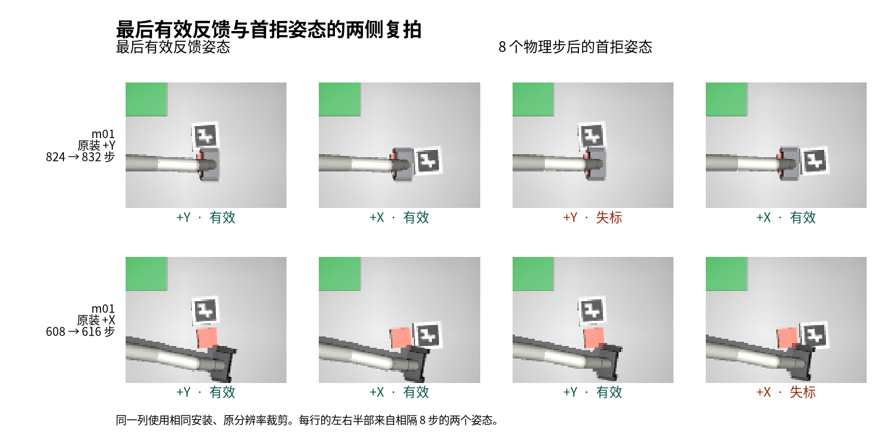

# G1 首拒失标复核与双标记开发试验

研发基线为 `3cc65630133bba0315907965b224e086c97950a4`。gpt-6.2-astra 在成像前固定了 16 个待复核姿态、双向互补判据、后续四对新摆放及计分方法。[主计划](plan.md) · [原件摘要与摆放分配](plan.json)

## 8 次 MOVE_ABOVE 为什么停止

8 次真实伺服都在上一帧取得抓取点后 8 个物理步（33.3 ms）首拒。每例均从控制器实际接受的目标回查到同一帧的 RGB-D 字节，并核对这两端及其间的 9 个连续物理状态。中间 7 步没有相机反馈。同一步另拍的终帧有独立的观测 ID。下表的“另一侧”是在相同关节、夹指、方块和相机姿态下换装重新成像的结果。[逐例帧、反馈和复位残差](refusal-pairs.public.json)

| 原试次 | 原安装 | 最后有效步 | 首拒步 | 此前累计接受的反馈 | 首拒时有效的另一侧 | 侵入白色静区的手或指像素 |
| --- | --- | ---: | ---: | ---: | --- | ---: |
| m01-original | +Y | 824 | 832 | 89 | +X | 17 |
| m01-selected | +X | 608 | 616 | 62 | +Y | 29 |
| m02-selected | +X | 632 | 640 | 65 | +Y | 9 |
| m02-original | +Y | 848 | 856 | 92 | +X | 29 |
| m03-original | +Y | 864 | 872 | 94 | +X | 26 |
| m03-selected | +X | 656 | 664 | 68 | +Y | 8 |
| m04-selected | +X | 576 | 584 | 58 | +Y | 10 |
| m04-original | +Y | 808 | 816 | 87 | +X | 18 |

在全部 8 张正常首拒图中，标记均在原顶视相机的画面内，OpenCV 直接识别和候选码精确回读均未取得 ID7，因而未进入五点深度解算。实例与深度复核显示，每张图都有 8–29 个手或指像素覆盖白色静区，比印刷面近至少 20 mm。7 张图的码格内没有手部像素，只有 m02-selected 的一个黑格像素被覆盖。保持同一姿态、噪声种子和标定，仅在渲染中隐藏手及双指，8 张均恢复直接识别与抓取点。每格约占 2.42 像素，对正常图作四种单轴 ±0.25 像素平移并双线性插值，有 5 张至少在一种平移下重新识别。这些对照支持白色静区和邻近手部轮廓影响候选检测，也显示对采样的敏感性。当前实验无法独立估计各手指、轮廓和插值各自的贡献。[实例、候选轮廓与深度诊断](refusal-diagnostics.public.json)

| 来源姿态 | 两侧有效 | 仅 +X 有效 | 仅 +Y 有效 | 均失标 |
| --- | ---: | ---: | ---: | ---: |
| 最后有效反馈，8 个姿态 | 8 | 0 | 0 | 0 |
| 首次拒绝反馈，8 个姿态 | 0 | 4 | 4 | 0 |

正常复拍中，每一侧单独覆盖 12/16 个姿态，两侧合计覆盖 16/16。将相同封存帧交给独立读回程序，16 对的分类全部一致。图中展示预登记前两例，每张图均取自原始 320 × 240 顶视画面的相同裁剪范围。[互补判定及见证帧](refusal-decision.public.json) · [独立读回](cross-readback.public.json) · [图像指纹](figure.public.json)

首次静态采集把恢复名义相机位置的管理记录计作了运动，完成一侧后被审计终止。该批的 91 项输入及失败记录均已封存。按 Astra 补充计划重新采集，逐项核对每侧 16 条相机管理记录、零物理积分和零动作派发。最终封存 32 张正常两侧复拍、32 张去手诊断和 24 张历史原图或终帧，同时保留 64 份实例分割。[相机审计补充计划](../round-g1-first-refusal-camera-audit-20261124/plan.md) · [审计与验证记录](../round-g1-first-refusal-camera-audit-20261124/step-report.md)

## 双标装配如何进入在线验证

开发场景将 ID7 安装在 +Y 侧 100 mm 处，ID8 安装在 +X 侧 100 mm 处。两个印刷码均宽 75 mm，白底边长 100 mm。每个估计均来自当前整幅 RGB-D 的有序角点和五处实测深度。仅一码几何有效时用该码；两码均有效时要求其抓取点相距不超过 10 mm，满足时选 ID7，冲突时拒绝。相机保持原 320 × 240、50° 顶视标定。v1、v2 的真实资产和开发登记各有独立指纹。[双标登记与试验安排](plan.md)

第一版使用有质量、可碰撞的高位平桥将两块板连接到方块。净距预检中，MuJoCo 3.3.7 的距离查询对三处支架与台面的组合返回 0。独立复算了 88 对几何，全部有严格正的分离下界；8 个台面对的实际垂直间隙均为 68.01 mm。实物接触模型的贴合与穿透负控均被拒绝。[几何核验和原 API 读数](../round-g1-dual-reset-clearance-20261124/clearance-validation.public.json) · [独立净距读回](../round-g1-dual-clearance-readback-20261124/step-report.md)

平桥在两个预定姿态的 6 个正控中均未能取得初始物体轮廓。在同姿态分割复拍中，6 张图的 RGB、深度和有效掩码与原图逐像素相同。姿态一的 60 个外环像素有 5 个深度不合格，姿态二的 64 个中也有 5 个。两种姿态各做 3 种显码条件，共 30 个不合格观测，实例标签在两条支架上各有 15 个。仅隐藏支架，30 处均见桌面，原颜色跟踪器在 6/6 张通过。随后用保留的正常实体在预定和备用共 6 个姿态跑完 76 个零步控制，三个正控条件均未取得一条完整可执行的抓取目标。[逐像素对照](../round-g1-dual-bootstrap-evidence-20261124/support-diagnostic.public.json) · [备用姿态与失败记录](../round-g1-dual-bootstrap-evidence-20261124/third-generation.independent-outcome.public.json)

Astra 为该原因预先限定一种低位 L 形支架。近方块一端的横梁低于方块顶面，外侧立柱托住原印刷板。印刷位置、颜色、相机、物体几何和控制器沿用原设定。带载板与支架的双标方块设计总质量为 100.78432 g，单标对照方块质量为 80 g。机械结构与视觉方案同时变化，因此两臂的实跑结果比较整个装配。[支架尺寸、物理质量及试验条件](../round-g1-dual-bootstrap-evidence-20261124/plan.json)

## 四对新摆放的完整抓放意图

低位支架在两个固定姿态通过全部 28 个零步控制后，按同一运行代签发 8 个槽。原 +Y 单标和双标在四个新摆放上各自独立复位，每槽均提交包含上方移动、接近、闭爪、抬升、移向目标、放置、释放和撤离的完整意图，各执行一次。真实保护或视觉拒绝触发后，保留该次原始结局。[实际分配](trial-allocation.public.json) · [独立资格与分配读回](allocation-readback.public.json) · [八个后端与作业回执](trial-acquisition.public.json)

| 摆放 | 原 +Y 单标的首停 | 低位双标的首停 | 双标接近帧有效 / 总数 |
| --- | --- | --- | ---: |
| d01 | 第 824 步，上方移动失标 | 第 1120 步，左夹指接触 ID7 载板，触发硬安全停止 | 39/39 |
| d02 | 第 848 步，上方移动失标 | 第 944 步，接近时两码均未识别 | 11/12 |
| d03 | 第 864 步，上方移动失标 | 第 992 步，接近时两码均未识别 | 15/16 |
| d04 | 第 120 步，视觉启动时无法确认顶面高度范围 | 同一原因、同一步停止，两臂均未派发动作 | 0 帧 |

d01 双标在停机步留下一个物理样本的左夹指与 ID7 载板接触，独立物理评价记录了非许可接触。该例接近动作在保护抛出前有 61 个后端命令；运行保留了命令记录和安全停止回执。其余 7 例在各自受检区间得到 `SCOPED_NO_VIOLATION`。全部 8 例的物体抬升量均为 0，均无双指夹住方块的样本。按原规则检查的抬升持稳窗和释放稳定窗分别要求 121 和 241 个连续样本，两臂均未进入这些窗口。[逐案接触、原命令、独立物理结局与窗口](paired-results.public.json)

| 新摆放上的指标 | 原 +Y 单标 | 低位双标 |
| --- | ---: | ---: |
| 完成上方移动并进入接近 / 分配 | 0/4 | 3/4 |
| 全部原采集帧中可定位的帧 | 287/293（97.95%） | 362/366（98.91%） |
| 可定位帧的物顶三维误差 P90 | 2.367 mm | 2.927 mm |
| 接近阶段可用 / 观测帧 | 无观测 | 65/67（97.01%） |
| 接近阶段有效帧的物顶三维误差 P90 | 无观测 | 2.885 mm |
| 完成全部在线动作 / 分配 | 0/4 | 0/4 |
| 独立物理抓放成功 / 分配 | 0/4 | 0/4 |
| 在线完成且物理成功 / 分配 | 0/4 | 0/4 |

双标 366 张原始帧中，272 张两码均可给出抓取点，45 张仅 ID7 可用，45 张仅 ID8 可用，4 张均不可用。接近阶段这四类分别为 5、23、37、2 张。原单标与双标均无闭爪或抬升在线观测，这两段的可见率和误差没有分母。全程统计中的每个采集帧只计一次，各阶段单独按来源帧和实际消费角色计数。[分动作、分标记的覆盖与误差](live-visibility.public.json)

两臂独立物理成功率的 Wilson 95% 区间均为 0–48.99%。四对摆放的成功率差为 0 个百分点，保守配对区间为 −66.56 至 +66.56 个百分点。双标让三个摆放进入接近；在本批的条件有效帧上，两臂的 P90 均低于 10 mm。G1 独立静态抓放成功率仍低于 90% 的开题指标。[配对结局、区间及原始分母](paired-results.public.json)

## 验证和原件

两个新进程分别从匿名、封存的 659 张 RGB-D 独立读出每个标记和抓取点，结果字节一致。解盲后按实际帧身份和动作时钟校验了 612 个伺服目标，端点复算残差最大为 0 mm。8 例共前进 5,832 个物理步，保存了 5,840 个连续物理样本，其中每例包含第 0 步。两个进程的输出分别与同一批原件重新联结，两次物理评分相同。[双进程复算](scoring-verification.public.json)

79 项本轮测试和 581 项历史回归均通过。主计划的 408 个输入摘要和运行前留存的 834 份文件再次核对；上轮八例的 811 个文件及文件集合均相符。逐一重新读取正式 v10 首组的 55,583 份冻结原件，共 6,578,143,222 字节，文件长度及 SHA256 全部匹配，原 claim 和数据库摘要相符。新增正式仿真、正式 claim、硬件派发及任务模型调用均为 0。仓库交付开发代码、两版开发资产、可读报告和派生数据；完整原始 RGB-D、实例、运行树和 SQLite 在本机私有证据目录中。[历史原件复核](preservation.public.json) · [源码、回归与交付清单](verification.public.json)
