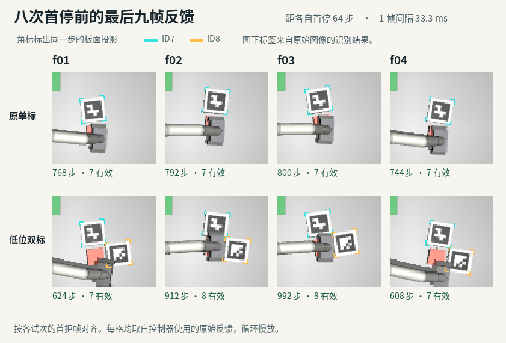

# G1 八次正式停机的逐帧复核

四个预登记摆放共留下八次正式试验。六次在标记识别阶段停止，两次在双标抓取点一致性检查停止。根据正式轨迹，八次的最后有效反馈与首拒之间，末端又移动了 1.79–3.40 mm，方块几何中心的记录位移均为 0。两种装配的完整抓放成功仍各为 0/4。本轮使用已有原件，新增正式试次和 claim 均为零。[正式配对结果](../round-g1-formal-paired-20261124/paired-results.public.json) · [观察计划](plan.md)

## 从最后有效反馈到首拒

每次试验的第一张有效动作反馈都在第 120 步。表中列的是随后控制器实际使用的帧。步进频率为 240 Hz，相邻反馈相隔 8 步，即 33.3 ms。这 7 个中间步均有物理记录，相机采样数为零。每次停机步另有一张终帧，有独立的帧 ID 和校验和。[反馈时间线](episode-timelines.public.json) · [逐步关联表](feedback-timeline.public.json.gz)

| 摆放 | 原单标最后有效 → 首拒 | 低位双标最后有效 → 首拒 | 双标停止动作与原因 |
| --- | --- | --- | --- |
| f01 | 824 → 832，ID7 → 无 | 680 → 688，ID7 → 两码冲突 | 上方移动，抓取点相距 13.391 mm |
| f02 | 848 → 856，ID7 → 无 | 968 → 976，ID8 → 无 | 接近，两码均未检出 |
| f03 | 856 → 864，ID7 → 无 | 1,048 → 1,056，两码 → 无 | 接近，两码均未检出 |
| f04 | 800 → 808，ID7 → 无 | 664 → 672，ID7 → 两码冲突 | 上方移动，抓取点相距 10.664 mm |

原单标四次都在上方移动时首停。双标 f02 靠 ID8 完成最后一次反馈，f03 在最后有效帧两码都可用。循环慢放把每个试次的首拒对齐为最后一格，覆盖其前 0.267 秒。青色和黄色角标是同一步真值投影的 ID7、ID8 纸板外沿，图下标签来自原始画面的识别结果。[原单标五个时刻](original-timeline.png) · [低位双标五个时刻](dual-timeline.png) · [裁图与投影出处](figures.public.json)

## 六次失标是怎样发生的

六张首拒帧涉及八块标记，印刷码和白色纸板都在画面内。把原深度和同一步的纸面投影逐像素比较，八块纸的白色外边都出现了比纸面近超过 20 mm 的前景。印刷编码区内，近超过 5 mm 的前景像素均为 0。四个单标姿态都只需在重绘中隐藏左夹指就能恢复 ID7，单独隐藏手掌或右夹指均未恢复。四张正常重绘与去手重绘之间，发生 RGB 变化的印区像素数也全为 0。[原图与同姿态重绘对照图](occlusion-comparison.public.png) · [遮挡读回](occlusion.public.json)

| 首拒 | ID7 白边前景 / 白边像素 | ID8 白边前景 / 白边像素 | 同姿态单独隐藏部件后恢复的码 |
| --- | ---: | ---: | --- |
| f01 原单标，第 832 步 | 21/165 | — | 左夹指 → ID7 |
| f02 原单标，第 856 步 | 24/163 | — | 左夹指 → ID7 |
| f03 原单标，第 864 步 | 18/162 | — | 左夹指 → ID7 |
| f04 原单标，第 808 步 | 11/163 | — | 左夹指 → ID7 |
| f02 低位双标，第 976 步 | 27/163 | 32/165 | 左夹指 → ID7，手掌 → ID8 |
| f03 低位双标，第 1,056 步 | 11/162 | 36/164 | 左夹指 → ID7 和 ID8 |

计数为板面投影覆盖的原生像素中心。前景主要覆盖 ID7 的 −Y 侧白边和 ID8 的 −X 侧白边。手掌和夹指可出现在同一块白边上。例如 f03 的 ID8 白边上有 30 个手掌像素和 6 个左夹指像素，单独隐藏左夹指已足以恢复识别。f01 原单标在第 824 和 832 步的白边覆盖数同为 21，前一帧仍检出。面积相同也能产生不同识别结果，这批证据把原因定位到局部白边及其相邻轮廓的外观。[逐帧区域计数](occlusion-frames.public.json.gz) · [逐姿态干预](occlusion-reconstructions.public.json.gz)

正式记录保留了 RGB、深度和有效掩膜。部件名称来自冻结模型的零步同姿态重绘。全部 778 帧里，纸板边界到图像边界的最小距离为 84.898 像素。共复核 47 个历史姿态，进行了 158 次静态渲染。原始 RGB 与正常重绘每幅最多有 23/76,800 个像素不同，共同有效区域的原始有噪深度与正常清洁重绘绝对差 P99 最大为 2.624 mm。47 个姿态的原始与正常重绘识别及理由相同。去手与正常条件使用配对深度，原图和正常重绘都有有效深度的位置保留原始深度残差。两个双标失标姿态去手后均重新检出两码，抓取点差分别为 2.274 和 4.321 mm。[独立投影、深度和分割计数复验](occlusion-verification.public.json)

## 两次抓取点冲突

在四个双标试次的 370 张控制反馈中，303 张能同时解算两码。按每张原始图像的有序角点和五处深度分别重建抓取点，实际超过 10 mm 的恰是 f01、f04 的首拒帧。两张图中，ID8 都由被直接检测器拒绝的四边形经码格精确回读取得。与同一步物理姿态对照，ID8 的偏航估计偏了约 5°。[逐码独立复算](conflict-summary.public.json) · [抓取点分解图](conflict-decomposition.png)

| 双标试次 | 上一张可同时测两码的反馈 | 随后仅 ID7 可用 | 首拒时 ID8 偏航误差 | 抓取点分歧 | 中心项 / 姿态经安装偏距放大项 |
| --- | --- | ---: | ---: | ---: | ---: |
| f01 | 第 584 步，2.208 mm | 连续 12 帧 | +5.711° | 13.391 mm | 3.328 / 10.062 mm |
| f04 | 第 616 步，4.348 mm | 连续 6 帧 | +5.038° | 10.664 mm | 1.189 / 9.475 mm |

f01 的 12 帧中，11 帧未检出 ID8。第 600 步虽读出了 ID8，四角深度中位数的极差却达 161.932 mm，反推出的四条边长约为 74、72、184、176 mm。原登记的边长为 75 mm，尺寸检查拒绝 ID8，控制器继续采用 ID7。f04 中间的 6 帧均未检出 ID8。[逐帧原生角点、候选与深度](pixels-frames.public.json.gz) · [在线姿态与用码回查](pixels-online-poses.public.json)

两项均投影到实际抓取点分歧方向后再相加，表中各数独立四舍五入。两码安装中心分别沿方块的 +Y、+X 偏置 100 mm，估计的朝向会直接影响从码中心反推的抓取点。首拒时，ID7 抓取点相对仿真真值的误差为 2.590 和 2.319 mm，ID8 分别为 12.475 和 10.737 mm。保留实测姿态并改用真值码中心，两码分歧为 10.373 和 9.490 mm。保留实测中心并改用真值姿态，则仅余 4.175 和 1.304 mm。f01 的姿态误差已足以越限，f04 还需要中心误差同向叠加。保留检测角点，仅将其深度换成真值平面交点，两次分歧仍为 13.375 和 10.300 mm。中间仅有单码可测，无法确定缺测期间的变化曲线。[全部双标反馈及深度替换对照](conflict-feedback.public.json.gz)

两次首拒的 ID8 角点相对于真实印区角点的均方根误差为 1.178 和 1.270 像素，ID7 为 0.545 和 0.469 像素。两码在原检测位置取得的五处深度中位数均距纸面不足 0.66 mm。f01 在 584 步也曾从被拒候选成功读出 ID8，当时抓取点误差只有 1.173 mm。同姿态隐藏手和双指后，两码抓取点差分别回到 **3.442 和 3.247 mm**。这些结果支持手部邻近轮廓影响 ID8 角点，偏航偏差再经安装偏距放大。根据目前分辨率，无法把轮廓、抗锯齿和角点细化各自的影响分开。

角点和深度会相互影响。把 f04 的检测角点移到真实投影位置、再从原深度图取样，会使 ID8 一个角的九个像素有六个落在前景，中位深度比纸面近 208.697 mm。该替换产生的形状不满足原有的尺寸、平面和直立条件。此项观察说明采样位置为何重要，正式首拒使用的仍是原检测角点。

## 原件与适用范围

两个新进程各自从封存的匿名 RGB-D 像素读完全部 778 张图，取得逐字节相同的结果，再与原始动作、物理状态和旧评分关联。734 张为控制器实际使用的反馈，726 张获接纳，8 张首拒。同一物理步的终帧各自保留。所有原始控制器、相机与登记输入的指纹在观察前后核对。[盲读封存](pixels-seal.public.json) · [新旧读回对照](pixels-summary.public.json) · [来源与交付核验](verification.public.json)

四个固定摆放的两组使用相同初始中心、朝向和种子。原单标装配总质量为 80.000 g，低位双标为 100.78432 g。这八次均在闭爪之前停机，闭爪、抬升和释放阶段缺少在线观测。原批结果只进入本次四对的正式分母，开题 90% 静态抓放指标仍未达到。[摆放和装配登记](../round-g1-formal-paired-20261124/trial-allocation.public.json)
