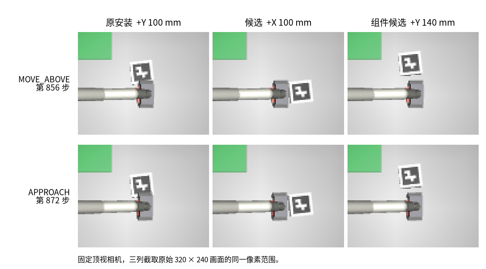

# G1 标记安装位置的停机姿态与独立抓放实验

2026 年 11 月 24 日，基线 `2ad38bc6214e9429b05488574b8b90e7b3184ad0`。开题 G1 指标要求物顶三维误差 P90 ≤10 mm、独立静态抓放成功率 ≥90%。本轮检验手部遮挡是否会因标记安装方位而改变，以及改变后机械臂能否仅凭原在线反馈完成抓放。开发试验包含 8 个历史停机姿态的配对复核、4 个全新摆放的 8 次闭环。位置和次序在查看本轮图像前已登记。[Astra 计划](plan.md) · [带输入指纹的登记](plan.json)

## 同一停机姿态下的安装比较

每一行均用相同的 8 个机械臂和方块状态、同一台名义顶视相机、同一配对深度噪声采集正常 RGB-D。系统先仅凭像素判断，再与步号、安装和独立物理状态联接。可用要求同时满足唯一 ID7、有效正深度和登记的伺服抓取点。误差为这些有效帧的物顶中心三维误差。

| 标记中心在方块坐标系的位置 | 可用 / 8 | 有效帧误差 P90 | 原生登记探针 |
| --- | ---: | ---: | ---: |
| 原安装，+Y 100 mm（r593） | 0/8 | 无有效帧 | 2/2 |
| +X 100 mm（r579） | 7/8 | 4.58 mm | 2/2 |
| +Y 140 mm（component_v1） | 8/8 | 9.45 mm | 0/2 |

原生登记拒绝了 +Y 140 mm 组件的资产与家族绑定。依预登记规则，选择 +X 100 mm 进入闭环。其唯一失标姿态是 `t03-translated` 的第 832 步。该步在名义顶视下有 30/167 个投影白色静区像素被更近的手部遮挡，印刷黑白格内的对应计数为 0。该帧支持遮挡与失标同时出现，单帧无法分辨其他成像因素的贡献。两种阴性输入各有 6 份，无标记和无效深度均触发拒绝，发出的动作数为 0。[逐姿态结果](screen-results.public.json) · [登记和负控](screen-controls.public.json) · [选择记录](selection.public.json)

图中每行固定同一源 episode 和物理步。三列在原 320 × 240 画面截取同一范围；像素来自完整机械臂，位置与深度评分使用原始全帧。[六幅原图的来源、步号及 SHA256](figure.public.json)

三组沿用 75 mm 编码、100 mm 白底、70 mm 方块，仿真中白底与方块同属一个刚体。两种 100 mm 安装的白底近缘与方块侧缘间有 15 mm 间距，140 mm 安装有 55 mm 间距。模型没有实体支架，真实支架的质量、碰撞与安装公差尚待实物验证。顶视位姿、视场、标定、原控制器与 SafetyShield 均沿用基线。独立运行树仅把伺服读取的标记家族绑定到当次登记，方块抓取目标始终按该安装的刚性变换回算。[几何核对](screen-geometry.public.json) · [运行树逐文件指纹](runtime-build.public.json)

## 四个新摆放的闭环

每个摆放各有两次独立物理重置，两种安装使用相同的方块位置、偏航和随机种子，按 AB/BA 交替顺序运行。每例发出完整八动作意图，保护停止即结束该例。表内是第一次且唯一一次执行的实测步数。

| 摆放 | 先运行的安装 | 原安装停止步 | +X 安装停止步 | 原安装 / +X 采集帧数 |
| --- | --- | ---: | ---: | ---: |
| m01 | 原安装 | 832 | 616 | 95 / 68 |
| m02 | +X | 856 | 640 | 98 / 71 |
| m03 | 原安装 | 872 | 664 | 100 / 74 |
| m04 | +X | 816 | 584 | 93 / 64 |

8 次均真实派发并返回了首动作 `MOVE_ABOVE`。控制器在最后一次反馈拒绝了抓取几何，8 份执行回执原因为 `servo registered marker geometry unavailable`。每例其后均有保持、急停命令和租约释放记录。没有发生采集进程中断。共记录 5,880 个物理步、5,888 个逐步状态和 663 帧正常 RGB-D。新安装在这四对摆放中都较早停止，停机姿态筛选的改善没有延伸到这些新摆放的首动作终点。[预分配与实际安装](trial-allocation.public.json) · [逐例重置、命令和回执](trial-acquisition.public.json)

| 新摆放指标 | 原安装 | +X 安装 |
| --- | ---: | ---: |
| 全程可定位帧 / 所有采集帧 | 378/386（97.93%） | 269/277（97.11%） |
| 可定位帧的物顶三维误差 P90 | 3.111 mm | 2.445 mm |
| 在线八动作全部通过 / 分配摆放 | 0/4 | 0/4 |
| 独立物理抓放成功 / 分配摆放 | 0/4 | 0/4 |
| 在线与物理都成功 / 分配摆放 | 0/4 | 0/4 |

每个摆放到首拒前 8 步的伺服反馈还能读出唯一 ID7，5 个光学深度样点有效。首拒反馈未检出 ID7，没有标记可供深度求解；同一步另拍的终帧得到相同结果。独立计算与控制器实际接受的 362 个原安装伺服目标和 253 个 +X 伺服目标全部一致。8 例物体最大抬升均为 0，均未形成规定的 121 点持物窗或 241 点释放稳定窗。观察区间内未发现受检的物理违规。原随动条件及 SafetyShield 已启用，本批首停由视觉控制器触发。每臂 0/4 的 Wilson 95% 区间为 0–48.99%。四对摆放的联合成功率差值为 0 个百分点，保守区间为 −66.56 至 +66.56 个百分点。[逐案成功判据及首拒帧](paired-results.public.json) · [二次独立复算](scoring-verification.public.json)

接近、闭爪、抬升在两臂各有 0/4 进入、0 帧在线观测。这三个阶段的在线可见率与误差 P90 均无分母。G1 的定位误差在可解算的开发帧上低于 10 mm；独立静态抓放成功率没有达到 90%。[各阶段动作、帧角色和采样间隔](phase-visibility.public.json)

## 在已完成抓放的轨迹上复核三个阶段

另取 11 月 23 日标准方块场景里一次固定 TCP 完整抓放的原始关节、两指和方块状态。该次原执行独立物理成功，连续保存了 5,014 个状态。从原始动作回执固定每段的开始、中点、终点，用两种安装和同一顶视相机重新拍摄。源轨迹没有在线标记反馈，新成像也没有驱动机械臂。相邻动作共用两个端点，每种安装实际拍了 7 张不同姿态的 RGB-D。两次独立判读一致。

| 阶段 | 固定物理步 | 原安装可用 / 抽查 | +X 安装可用 / 抽查 |
| --- | --- | ---: | ---: |
| 接近 | 630、902、1175 | 2/3，630 步失标 | 2/3，902 步失标 |
| 闭爪 | 1175、1294、1414 | 3/3 | 3/3 |
| 抬升 | 1414、1999、2584 | 3/3 | 3/3 |

两种安装在接近时失标的位置不同。闭爪、抬升各三处姿态均能给出抓取点，三个抽样点之间的连续可见性仍未知。14 张图均通过源姿态、标定和变换核对，最大 TCP 复位残差 2.434 µm，原门限 10 µm。[逐帧结果与位姿残差](phase-reconstruction.public.json) · [从源状态和 RGB-D 的独立复核](phase-verification.public.json)

最初登记的 T5 正控使用黄色、非等边方块，目标区半宽为 70 mm，原视场为 45°。本轮标准场景对应红色 70 mm 方块、目标区半宽 80 mm 和 50° 视场。T5 的 7 个原姿态、9 个阶段角色和场景差异均已保留，在名义场景阶段表中的贡献为 0。另一次阶段入口在拍摄前将正向运动学的三项误差与含六项的图像复现检查表作了全表比较，因而拒绝启动。修复绑定后重新读回全部参考姿态；原三项运动学门限和原三项图像复核门限取值均有字节记录。[参考轨迹补充报告](../round-g1-marker-mount-phase-reference-20261124/step-report.md) · [运动学校验修复与负控](../round-g1-marker-mount-phase-fk-20261124/step-report.md)

## 验证与复算范围

从原始像素、实例标签和深度二次复核了 24 张停机正常图、登记探针和负控。另从独立进程重判 663 张在线帧，按身份、时间、动作边界、命令和完整物理窗口复算八例。分组、首拒步、窗口状态和逐帧数值一致。项目原标记、原伺服及安全盾等 581 项定向测试在 EGL 环境通过。早期有一次历史渲染测试未设置 EGL，进程退出 134；在登记环境回归通过，该次未占用任何实验摆放。阶段报告和公开实验清单随仓库交付，完整 RGB-D、SQLite、运行树和密集状态保存在本机。[停机帧独立核查](screen-verification.public.json) · [验证记录与原件指纹](verification.public.json)

本轮新增正式仿真、正式 claim、硬件派发及任务模型调用均为 0。历史 v10 首组的 claim 和数据库摘要与 Phase 6 记录相符。重新读取该组冻结清单全部 55,583 份原件，共 6,578,143,222 字节，每一份的长度和 SHA256 均与清单一致。G1 的独立静态抓放指标仍待满足。

复核历史开发例 `t01-nominal` 的 SQLite 数据库时，只读连接在其原目录创建了 0 字节的 WAL 和 32 KiB 的共享内存辅助文件，两者现已留存。该例数据库的修改时间仍为历史采集时刻，当前 SHA256 为 `337a408c2555c7d3cbfedad97e3329e0287f248ac3302468f6404956e11a589d`，此前没有该库的逐文件摘要可直接比较。主计划冻结的全部 198 项输入及另行核对的正式库和 claim 都通过哈希复验。后续数据库读回已使用 SQLite 不可变只读连接。
