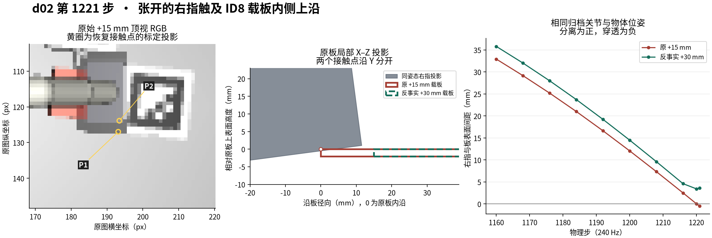

# d02 第 1221 步的右指与 ID8 载板接触

+15 mm 装配在 APPROACH 下降时，张开的右指端部扫到 ID8 载板靠近方块一侧的上沿。第 1220 步仅余 **0.056 mm** 净距，第 1221 步原始轨迹登记两个右指—载板接触点，随后触发硬安全停止。把已登记的 +30 mm 载板放入完全相同的姿态后，第 1220、1221 步的表面净距分别为 **3.440、3.609 mm**。3432 个归档姿态的独立全轨筛查也将 1220 步定位为 +30 mm 装配的最窄手板间隙。[逐点证据](finger-plate-contact.public.json) [全轨静态结果](screen-clearance-summary.public.json)

## 接触点及侧向

原始归档保存了每个物理步的关节、指位、物体位姿和接触几何体名称。两点的位置、法向和局部表面坐标来自原 XML 上相同状态的零积分 MuJoCo 前向重建。两个接触的几何体顺序均为 10 号右指盒与 52 号 ID8 载板盒。板局部 +X 为径向外移方向，−X 端朝向方块，+Z 为上表面。

| 接触 | 世界坐标中点，mm | 原模型重建带符号距离，mm | 指表面局部坐标，mm | 板表面局部坐标，mm |
| --- | --- | ---: | --- | --- |
| P1 | 523.888, −38.643, 69.701 | −0.487505 | +35.000, −8.000, +16.361 | −50.000, −48.372, +1.000 |
| P2 | 525.480, −22.643, 69.847 | −0.193736 | +35.000, +8.000, +17.975 | −50.000, −32.294, +1.000 |

右指盒半尺寸为 35、8、28 mm，载板半尺寸为 50、50、1 mm。两点都落在原板 −X 与 +Z 的公共棱上，P1 距板的 −Y 端仅 1.628 mm。右指侧两点都落在 +X 端，分别位于 −Y 与 +Y 的两条棱。从右指向板的世界单位法向为 **(+0.130025, −0.013041, −0.991425)**，转换到板局部为 **(+0.131347, 0, −0.991336)**。原终帧 320×240 RGB 中，两点的重建投影分别为 (193.138, 126.975) 与 (193.450, 123.881) px。[图像生成源](contact_figure.py)

## 接触前八次反馈

下列八次均由当帧反馈独立读取。第 1168 步采用 ID7 单侧，其他七步采用两个可用标记。原生反馈窗口最大 48.123 ms。间距列由两盒顶点、面及棱对的最近点独立计算。MuJoCo 距离 API 在 +15 的 1184、1216 步及 +30 的 1184 步返回零且没有接触；相应步骤有严格正的盒分离轴证明，原 API 读数一并保留。[反馈、几何与相机来源](finger-plate-contact.public.json)

| 物理步 | 原包 | 原生反馈窗口，ms | 原 +15 指板净距，mm | 同姿态 +30 指板净距，mm |
| ---: | --- | ---: | ---: | ---: |
| 1160 | 0137 | 44.671 | 32.930 | 35.813 |
| 1168 | 0138 | 46.841 | 29.162 | 32.024 |
| 1176 | 0139 | 48.123 | 25.193 | 27.998 |
| 1184 | 0140 | 42.952 | 21.014 | 23.727 |
| 1192 | 0141 | 47.611 | 16.630 | 19.219 |
| 1200 | 0142 | 40.567 | 12.066 | 14.506 |
| 1208 | 0143 | 40.502 | 7.349 | 9.619 |
| 1216 | 0144 | 42.145 | 2.510 | 4.610 |

第 1217 步发出最后一条关节目标。原板随后在 1217、1218、1219、1220 步依次剩下 1.898、1.285、0.671、0.056 mm 净距。最后一个物理步内，P1 对应的指表面材质点沿最终接触法向前进 0.577 mm，板材质点同向移动 0.033 mm，相对间距收缩 0.544 mm。P2 的相应值为 0.582、0.029、0.553 mm。从第 1160 步算起，两个指表面点在世界 Z 轴分别下降 38.044、38.157 mm，同期板点各下降约 0.03 mm。该段中夹爪保持打开。第 1221 步后台顺序记录两条保持当前关节位置的命令和急停，SAFE_STOP 成功，GRASP 尚未执行。[材质点位移与原命令](finger-plate-contact.public.json)

## 同姿态 +30 mm 核查

第 1220 步两种装配均重建出四个桌—方块点。第 1221 步 +15 mm 重建出两个桌—方块点和两个右指—ID8 载板点，与源轨迹的名称及多重数一致；+30 mm 只重建出两个桌—方块点。+30 载板在第 1221 步的 15 条候选分离轴中，板局部 X 轴给出严格正的 **3.456339 mm** 投影间隙下界。两盒表面的独立特征枚举和 MuJoCo 距离 API 均为 **3.608758 mm**，最近特征变为右指的 +X/−Y/+Z 角与板的 −X/+Z 棱。该对在此姿态所需的额外外移量为 0 mm。

本次局部读回覆盖两个登记 XML、13 个保存姿态和原始终帧 \`0145.json\`。恢复的 TCP 对归档值最大相差 0.0463 mm，物体几何中心残差为零，旋转矩阵只差浮点舍入。第 1221 步的 +15 双接触已经进入实际开发失败记录，+30 的间隙数值属于同姿态静态反事实。[零步重建源](contact_witness.py)
