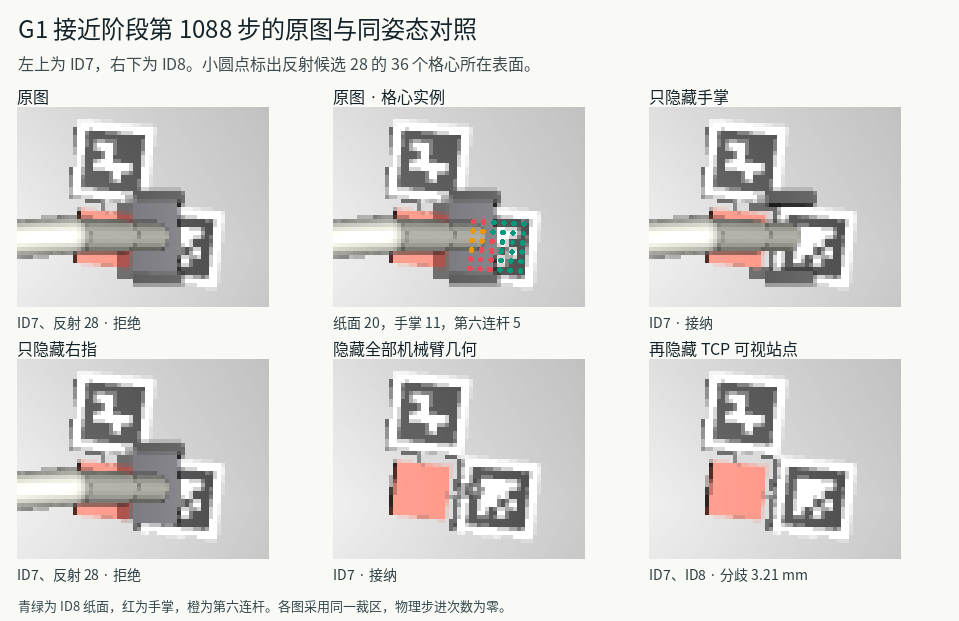

# 第 1088 步的镜像候选来自被遮挡的 ID8 印区

历史开发摆放 d02 通过上方移动，随后在接近阶段第 1088 步停机。当帧读出正面 ID7 和一个只匹配镜像 ID28 的图样，观察器按身份歧义拒绝。这个图样的中心距登记的 ID8 投影中心 0.325 像素。把 36 个格心逐一对应到同姿态重绘的实例图，20 个落在 ID8 印刷格上，11 个落在手掌，5 个落在第六连杆。三个表面的当帧光学深度中位数依次为 1,329.65、1,145.24 和 1,133.54 mm。[逐格证据](old-board-pixels.public.json.gz) · [独立原像素与射线复核](old-board-verification.public.json)

| 第 1088 步同姿态画面 | 按冻结观察器读到的图样 | 控制反馈判定 |
| --- | --- | --- |
| 原图和正常重绘 | 正面 7、镜像 28 | 身份歧义，拒绝 |
| 只隐藏左指，或只隐藏右指 | 正面 7、镜像 28 | 身份歧义，拒绝 |
| 只隐藏手掌，或只隐藏第六连杆 | 正面 7 | 单码接纳 |
| 同时隐藏手掌和双指 | 正面 7 | 单码接纳 |
| 隐藏全部机械臂几何体 | 正面 7 | 单码接纳 |
| 在上一条件下再隐藏手端的 TCP 可视站点 | 正面 7、正面 8 | 两码接纳，抓取点相差 3.214 mm |

原图中，ID8 印区 211 个像素中心有 88 个比印面近逾 20 mm，内部数据区为 33/95。88 个前景像素中，手掌占 61 个，第六连杆占 21 个，右指占 6 个。ID7 印区为 0/210。第 1056、1064、1072、1080 步，ID8 印区的对应前景计数分别为 73、87、88、88，这四张反馈均可仅凭 ID7 继续。第 1088 步镜像候选的亮暗对比为 135 灰阶，留出边残差 RMS 为 0.275 像素。相同的遮挡面积下，局部图样才决定是否形成另一个码词。[六张开发帧与全部干预结果](old-board-observation.public.json)

隐藏机器人物理几何后，TCP 可视站点仍叠在 ID8 左侧。再单独隐藏这个站点仅改变 25 个原生 RGB 像素，原观察器随即重新读到 ID8。这个对照解释了为什么只去掉手部几何就能清除镜像 28，却仍可能只能使用 ID7。实际控制继续使用原相机、原站点、全字典验证和原 10 mm 双码分歧边界。[同姿态重建与像素读回源码](old_board_pixels.py)

共复核 22 张独立原帧，其中 6 张来自 d02，涵盖 1056 至 1088 步和同一步独立终帧。另 16 张来自八个原正式试次的末次有效反馈与首拒。118 次静态重绘均只执行正向运动学，物理推进次数为零。22 张正常重绘均重现当帧修复版的身份和裁决，原始 RGB 与正常重绘的全图差异最多 15/76,800 像素。原始有噪深度与正常清洁深度在共同有效区域的绝对误差 P99，各帧最高为 2.610 mm。独立程序复查了 72 项原帧区域计数及 45,500 项原生像素贡献。[验证程序](old_board_verify.py) · [验证结果](old-board-verification.public.json)

上述真值投影和实例名称均用于回顾归因。在线输入仅包含当帧 RGB-D 与登记几何。本轮旧板观察新增正式或实机试次数均为零，新的安装位置需独立评估。
