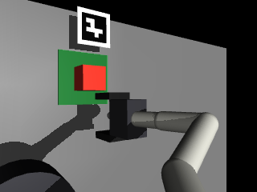

# 抓放修复与移动相机验证

已实施注册 MuJoCo 场景中的抓放修复，并把相机扩展为运行时可移动、可倾斜、逐帧使用完整外参的观测设备。最终同一源码的 `worker-final-11/12/13` 均完成抬升、运输、放置、释放和撤离，独立物理评分成功，终帧标记 OBSERVED。

这是固定场景开发重复性验证。真实 worker、SQLite、RGBD、OpenCV、SafetyShield、关节指令和 MuJoCo 物理均运行；Sol/Molmo 使用现有协议替身，外部付费模型调用为零，硬件操作为零。三次重复不能证明未见场景成功率、真机能力或硬实时保证。



上图是最终 worker11 未改动终帧的副本，仅作结果示例；成功判定使用逐物理步独立证据。

## 最终结果

| 检查 | 实际结果 |
|---|---|
| 最终源码完整抓放 | 固定场景 3/3 完成，诊断完成、无终止错误 |
| 实际抬升 | 三次均为 105.617 mm |
| 连续持物 | 三次均为 3.1875 s |
| 稳定落位 | 三次均为 9.4417 s |
| 连续普通指令验证 | 每次 1,184 个间隔、4 处跨动作交接 |
| 最大发送目标速度/加速度 | 0.500000000000032 rad/s、1.666666666667383 rad/s²，含浮点舍入 |
| 视觉墙钟频率 | 各运动段 21.516–33.712 Hz |
| 最慢已接受采样 | 85.577 ms，原期限 100 ms |
| 完整 worker 墙钟用时 | 36.43–37.22 s |
| 最终源码相关回归 | 220 passed，含一次 LIFT 丢标记故障注入 |
| 独立视觉门槛 | 三轮共 12 项通过，包含丢失后的预期停止 |
| 静态检查 | 30 个修改 Python 文件 Ruff 通过；17 个修改源码文件 mypy 通过（follow-imports=silent） |

物理标准保持：物体实际抬升至少 50 mm、连续持物至少 0.5 s、释放后稳定落位至少 1 s；TCP 收敛、双侧接触或 pytest 通过不能替代这些标准。已检查范围内无物理安全违规。

视觉每 8 个物理步采样，即 30 Hz 仿真周期；关节发送每 5 步，即 48 Hz 仿真周期。墙钟数据单列，不能当作硬实时保证。持物运动段冻结目的地和工具姿态，本轮未验证运动中切换目的地，也没有优化最短抓放周期。

## 修复内容

- 低位 LIFT/RETREAT 使用不可变竖直路径，绑定 task、step、skill、起点及冻结终点；最低高度至少 80 mm，逐物理步检查横向偏离和回落各不超过 1 mm。没有显式路径时保留原严格规则。
- LIFT、MOVE_TO_REGION、PLACE 每个物理步核验双侧实际持物反馈；丢失在下一条关节命令前 hold。预期持物 ID 由可信执行层传入，所有异常出口取消轨迹。
- 持物运输和放置跟踪四秒平滑笛卡尔参考，使用机器人关节反馈、机器人惯性/阻尼前馈及负载估计，经原 joint_target 接口发送；不读取物体自由关节真值来控制。普通动作交接继承最后发送目标、速度和时间，连续核验交接边界。
- 每帧完整旋转、平移外参与对应标定用于反投影。相机候选来自当前注册标记与初始实测工作区；LIFT 前准备包含冻结抬升高度的候选，只有当前可恢复的可见性错误才触发新视角。MOVE 使用两侧恢复；PLACE 开始前重新采集实测斜上方总览，避免下降采样中重复经历已观测的侧视遮挡。
- 动态恢复最多两次换视角，所有捕获、归档、视觉和安全检查仍计入原 100 ms 采样期限；相机调整不推进机器人仿真。新帧必须重新通过身份、标定、深度、直立与安全检查，不能复用失败帧或重置原任务/步骤预算。
- 静止目标区按当前外参重投影，至少需要三个当前角点锚；每个缺色像素需要当前前景解释。内部尖峰、无效深度、异色、独立孔洞及共面纯色缺口继续拒绝。低位侧壁必须具有当前正高度且连接到高前景。
- 未标定的一像素混合边界仅用于开发可见性排除，不计为平面支持，不授予完整几何资格。标定输入沿完整像素光线传播深度误差到世界 Z，并计入像素足迹与深度误差交叉项。
- 高频新帧使用无损 PNG 0，标记深度直接读取原始 float32；原有默认编码和历史字节保持。新增 DEVELOPMENT_ONLY 的 v4 标记注册，只继任身份及两项源码绑定；v1/v2/v3 原件及其严格拒绝检查保留。

RETREAT 的终点来自机器人反馈，不消费无关目标区几何；MOVE/PLACE 仍要求当前目标区支持。低位 RETREAT 先竖直脱离再完成原横向终点，共用原步骤时钟。手指指令轨迹、资产、机器人工作空间/关节边界、原速度/加速度上限及物理验收没有修改。

## 失败原件与最后一轮调整

早期 worker-active-camera-11/12/13 物理成功，但旧验证器按动作切片，漏掉交接加速度超限，因此不能作为最终指令限制证明。修复后的 worker-final-05/06/07 曾完成旧源码版本的三次重复；随后整库续测真实复现 LIFT 丢标记，暴露“备用视角直到运输才准备”的缺口。该次完整 raw 单独保留于 `regression-worker-v4-lift-failure`。

显式一次 LIFT 丢标记回归先以原实现失败（9.82 s），补齐候选后完成物理抓放（36.60 s）。之后预定的 worker-final-08/09/10 中，08 成功，09/10 均在 PLACE 同一换视角点超出原期限，分别为 111.080 ms、115.866 ms。它们是实际失败，不能通过挑选成功试次消失；其原因不是已证明的 MSAA 或其他未经核实的渲染归因。

最后将总览相机的重新获取提前到 PLACE 开始前。最终预定 worker-final-11/12/13 全部完成；最终 220 项相关回归再次运行了 LIFT 故障注入，并核验 PLACE 首帧使用提前准备的相机和相同物理步入口。此前超时仍保留在各自源码版本中。当前测量不消除操作系统、归档和相机恢复的运行时延风险。

只读复核同时检查两次旧版本超时：在物理步 4880 hold/estop，该步及之后没有新的普通关节目标。停止响应的发送语义不代表实际接触/停止加速度上界。

## 独立审查与整库验证范围

一次 `gpt-6-astra` 全改动只读审查给出两项 Important，无 Critical/Minor。原文见 [review-raw.md](review-raw.md)，输入及 SHA256 见 [review-request.md](review-request.md) 和 [review-input-manifest.json](review-input-manifest.json)。31 项审查输入快照的 SHA256 为 `32b41692453976a05f3ed84be80b8f9244555a53c1e3f2d22b38cb1be8cd795e`。它不是修复后最终树的重新审查或批准。

1. 旧控制器在保留平衡载荷目标后从实测 qpos 重置，导致交接加速度达 7.52537 rad/s²；已以即时/有间隔的真实连续交接回归完成 RED→GREEN，并改为继承最后目标与速度。
2. 斜视误差曾仅使用 R[2,2]；解析离轴 RGBD 在阈值附近复现误接受，现沿完整光线传播并加入交叉项，阈值上下 5 μm 的拒绝/接受回归均通过。

整库分段核对 **7,088 项**：**7,043 passed、32 skipped、3 failed、1 error、9 未完成**。这是最后相机阶段修复前的源码快照，来源与逐节点清单绑定见 [regression-summary.json](regression-summary.json)。四项失败/错误的归属为：

| 用例 | 结果与处理 |
|---|---|
| 历史 finger-limit 源码 pin 核验 | 基线 f258 已与旧 52df pin 不一致；独立复现，不修改历史核验器 |
| cloud-fallback 的 seed43001 development CANDIDATE | 期望执行 0 次，实际 8；完整基线独立复现 |
| repeated-identical-batches teardown | 断言通过但调度线程未退出；新鲜重试及完整基线独立复现 |
| 完整伺服 worker 的 LIFT 可见性 | 本轮实际问题；在整库结果之后修复并重新验证，原失败保留 |

九项未完成包括一次原因未明的进程 `-11` 与八项 120 秒限时。进程退出时间早于后续中断请求，旧“中断附近退出”的推测已更正且原记录保留。同类完整基线也超过 120 秒，但不能据此证明基线同样会 `-11`。这些检查未通过，native/正式验收未授予。

记录器自身也有两个已确认问题：v3 相对路径被切换 cwd 的测试打断；v4 的顶层入口被 multiprocessing spawn 重新执行而遇到 O_EXCL/FileExistsError。原日志和事件保留；前者使用绝对路径及 OS 文件描述符续测，后者用原生 `python -m pytest` 单独复核跨进程锁，通过。未把观察器故障归因于机器人代码。

另有环境记录：沙箱异步唤醒阻塞，同一用例内 40 秒超时、沙箱外 0.50 秒通过；相对 PYTHONPATH 导致子进程导入失败，改为绝对 `src:仓库根目录` 后五项全部通过。后续实际运行在沙箱外使用正确路径。

最后新增一项回归后当前共收集 **7,089 项**。最终源码运行了上述 **220 项相关回归和三次完整 worker**，没有再次重跑全部 7,089 项。分段合并结果是派生清单，原生日志、逐测试事件与各段 JUnit 均保留；不存在一次无中断、最终源码全绿的完整整库 JUnit。独立视觉三轮使用的控制/视觉源码未在最后组件相机阶段修复中变更。

## 证据与复核

完整本地 raw：`experiments/results/phase9/grasp-place-repair-20261117`。所有历史失败、成功、逐物理步反馈、发送指令、RGBD、标定、数据库及日志保留。清单和派生报告不能冒充完整远端复现包；完整批量 raw、运行数据库、权重、SDK 和凭据不随本次代码提交交付。

- [validation-runs.json](validation-runs.json) 指定最终三次 worker、三轮视觉门槛和两次旧版本期限停止。
- [source-manifest.json](source-manifest.json) 绑定 65 项最终源码、测试、资产/配置及复核工具；整库旧快照另存于 raw。
- [raw-manifest.json.gz](raw-manifest.json.gz) 绑定 103,371 个常规文件（14.502 GB）与 49 项便利符号链接目标元数据；不跟随链接读取外部证据。
- [verification-summary.json](verification-summary.json) 独立重建 4,254 份配对帧，重算最终物理评分，检查路径、持物、连续指令、最终运行源码绑定及保留超时的停止行为。
- [environment.json](environment.json) 记录当前工具与依赖版本。

```bash
PYTHONPATH="$PWD/src:$PWD" .venv/bin/python \
  artifacts/research/process/20261117-grasp-place-repair/verify_evidence.py
```

raw 位于其他目录时增加 `--raw-root /absolute/path`。验证器只读，不修改任何原始证据。

## 裁定与未授予的范围

仿真相机位置和朝向变化已获用户授权；真实相机执行器、移动时延、真实模型表现、真机和硬实时均未验证。新 seed 泛化为 NOT_TESTED，正式/native/硬件资格维持 NOT_ACCEPTED/UNKNOWN。

发送目标 slew 限制不等于实际接触加速度界：独立对照曾观测约 9.50 rad/s² 实际差分加速度。原 backend ±0.10 rad 跟踪误差夹限保留且可能触发。显式 hold/estop 保留原即时停止语义并重置连续验证段，普通动作边界不重置。没有延后的审查 Minor。

本地研发分支为 `codex/v4-marker-ambiguity-20261115`，公开推送继续暂缓；本地提交标识在交付消息中提供。

## 执行裁定原文

按发生顺序保留八项裁定，含理由和代价：

1. Task 2: Ruling: camera direction is now movable under the user's explicit steering; use full current-frame extrinsics and bounded active viewpoint changes — fixed top view caused repeated occlusion and forced slow transport detours — simulation view changes do not validate any physical camera actuator or its latency.

2. Task 2: Ruling: uncalibrated current boundary mixtures are visibility uncertainty, never complete plane geometry — sampled pixels demonstrably mix RGB foreground/green with plane depth, all adjacent to measured foreground — a wrong explanation can admit one-pixel visibility ambiguity, so formal/native/hardware qualification stays UNKNOWN and independent physical scoring remains mandatory.

3. Task 2: Ruling: choose the minimal4s robot-only Cartesian reference for held transport/PLACE — far-goal joint interpolation physically tilted12.45deg, while independent minimal/retimed controls both retained upright transport and the simpler reference met the fixed-scene need — endpoints remain frozen during held motion and this does not establish arbitrary moving-destination control or minimum cycle time.

4. Final: Ruling: append a DEVELOPMENT_ONLY v4 marker registration and retain strict historical replay checks — two optimized source files invalidate frozen v3 as intended, while baselinef258 already fails the old52df replay verifier — old byte pins and old replay authority remain frozen; the new registry grants no native/formal admission and the baseline test failure is reported.

5. Final: Ruling: the review's deferred judgments remain outside the evidence claim — only simulation and protocol stubs were authorized and measured; ordinary target slew is checked across actions, with explicit hold/estop retaining old immediate-stop semantics — hardware/camera latency, real model behavior, new-seed/formal/native qualification and actual contact/stop acceleration bounds remain unproven.

6. Final: Ruling: bound the existing pathological CPU authorization cohort and continue the rest with exact per-node accounting — baseline also exceeds120s, one full process exited-11 during delayed trace output, and the unchanged legacy protocol is outside this simulation repair's native acceptance — nine closure checks remain explicitly uncompleted (one-11, eight120s timeouts); no timeout/crash is converted to PASS or qualification. Phase12 software validation assertions still execute real independent pipelines without cached verdicts, scheduled in separate CPU processes to reduce wall time; no graphics-graphics overlap.

7. Final: Ruling: prepare measured alternative camera views before LIFT, including its frozen planned height, and activate them only after a recoverable current-frame loss — a real broad-run lift stopped with no prepared alternatives before transport, and the explicit one-loss actual-worker regression observed RED in9.82s — extra capture can still exhaust the unchanged100ms/two-view budget and must stop; old worker05/06/07 cannot bind the later component source and final actual runs must be renewed. This is a new narrow integration root, not a second review pass or a native/paid-model qualification.

8. Final: Ruling: select and reacquire the measured oblique overview before PLACE starts — two independent final attempts hit the same side-to-overview transition and spent two captures in one100ms motion sample — the view must pass the ordinary fresh pre-step geometry checks; if it cannot, the action still stops, and this does not establish hard realtime or physical camera motion latency. Neither task nor step budgets are reset, and all earlier timeout failures remain counted in their original revision.
